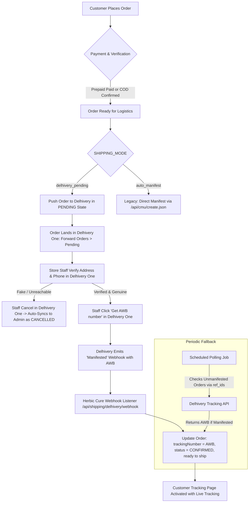

# Implementation Plan: Delhivery One Pending Flow (Order Management Mode)

## 1. Executive Summary & Objective

Today, Herbic Cure creates and manifests Delhivery consignments directly via API calls to `/api/cmu/create.json`. When this endpoint is called without a pre-existing waybill, Delhivery's Client Manifestation Unit (CMU) immediately binds an AWB number, registers the shipment into "Ready to Ship" (manifested) status, and—for prepaid/wallet accounts—deducts courier charges immediately.

**New Goal**:
Transition the fulfillment lifecycle to **Delhivery One Order Management Mode**:
1. When an order is confirmed (Prepaid payment verified or COD placed/advance verified), our system transmits the order to Delhivery in the **PENDING (draft / unmanifested)** state.
2. Delhivery wallet balance / courier freight is **NOT** deducted at checkout.
3. Store staff log into the **Delhivery One Dashboard** (`Main Menu > Orders > Forward Orders > Pending`), review customer address/phone and order details, filter out fake orders, and click **"Get AWB number"** (manifest).
4. Our admin panel stops creating shipments directly and becomes a **Read-Only Logistics Viewer** showing live Delhivery status, last-synced timestamp, and the AWB once generated.
5. As staff manifest orders and couriers pick up packages, Delhivery pushes status updates back via webhooks (and fallback scheduled polling), which automatically updates our database and customer tracking.
6. The entire flow is placed behind a reversible configuration flag (`SHIPPING_MODE = 'delhivery_pending' | 'auto_manifest'`).

---

## 2. Research & What Delhivery Official Documentation Says

Based on Delhivery One official developer documentation, knowledge base articles, and merchant API guides:

### 2.1 Direct Manifestation vs. Order Management Mode
* **Direct Manifestation Mode (Default Last-Mile API)**:
  * Uses `POST https://track.delhivery.com/api/cmu/create.json` (or `staging-express.delhivery.com`).
  * Designed for high-volume enterprise ERPs/WMS. Every order submitted is immediately manifested, an AWB is allocated, and the package skips the dashboard review queue straight to "Ready to Ship" or "Manifested".
* **Order Management Mode (Dashboard Staging Queue)**:
  * Enabled in Delhivery One under **Services / Value Added Services > Order Management** (or via Sales Channel integrations like Shopify, WooCommerce, or Custom Channels).
  * Orders created in this mode land in **Orders > Forward Orders > Pending**.
  * In the **Pending** tab:
    * No AWB is locked.
    * No freight charges are deducted from prepaid wallets.
    * Staff can inspect consignee phone, edit delivery addresses, modify package weight/dimensions, change pickup warehouses, or cancel fake orders with ₹0 cost.
    * Staff select orders and click **"Get AWB number"** (or click Manifest). This assigns the AWB, deducts wallet charges (for prepaid accounts), and moves the order to **Ready to Ship**.

### 2.2 Critical API Findings & Ambiguities
* While sales channels (Shopify, WooCommerce) natively feed into the **Pending** queue, custom REST API integration into Delhivery One's Pending queue depends on account-level configuration:
  * Some Delhivery accounts configured in **Order Management Mode** automatically place `/api/cmu/create.json` orders into **Pending** unless an explicit manifestation call is made.
  * In other configurations, `/api/cmu/create.json` always bypasses Pending and immediately manifests unless a channel-specific payload or custom flag is provided.
* **Per Rule 2**, we do NOT assume the API behavior. The questions below must be confirmed with Delhivery Support before switching production traffic.

---

## 3. Exact Questions for Delhivery Support / Account Manager

Copy and send the following exact questions to your Delhivery Account Manager or Delhivery Support (`support@delhivery.com` / Delhivery One Support Ticket):

> **Subject**: Herbic Cure - Order Management API Integration: Pushing Orders to Pending (Unmanifested) Queue
>
> Dear Delhivery Technical Support / Account Team,
>
> We are integrating our custom e-commerce store (Herbic Cure) with Delhivery One. Our fulfillment workflow requires orders to arrive in the **Pending** state so our warehouse staff can verify consignee details before manifesting in the Delhivery One dashboard:
>
> 1. **Account Mode Verification**:
>    Is our Delhivery One account (`HERBIC CURE`, Client ID / Phone: `8688888114`) currently configured in **Order Management Mode** or **Direct Manifestation Mode**? If it is in Direct Manifestation, please enable Order Management Mode for our account.
>
> 2. **API Endpoint & Parameters for Pending (Draft) Orders**:
>    Which API endpoint and request payload should we use to push custom orders into **Orders > Forward Orders > Pending** without immediately assigning an AWB or deducting freight charges?
>    - Does `/api/cmu/create.json` automatically stage orders in **Pending** once Order Management mode is active on our account?
>    - Or is there a specific payload parameter/flag (e.g. `is_manifested: false`, `status: "draft"`, or channel mapping) required?
>    - Or does Delhivery One have a dedicated Custom Channel Order Ingestion endpoint?
>
> 3. **AWB & Status Discovery After Dashboard Manifestation**:
>    Once our staff select an order in the Delhivery One dashboard and click **"Get AWB number"**:
>    - Does your **Scan Push Webhook** immediately emit a `"Manifested"` scan event containing both our `ReferenceNo` (Order ID) and the newly assigned `AWB`?
>    - If we poll via GET `https://track.delhivery.com/api/v1/packages/json/?ref_ids=ORDER_ID`, does it return the newly generated AWB and status once manifested, or does `ref_ids` only work after physical pickup?
>
> 4. **Mandatory Fields for Pending Staging**:
>    What are the exact mandatory fields required to successfully stage an order in the Pending tab (e.g., consignee address, 10-digit phone, warehouse name, dimensions, weight, declared value, COD balance)?

---

## 4. Architectural & System Design

---

### 4.1 Reversibility & Configuration Flags

We introduce a store setting key in `prisma.siteSetting`:
* **Key**: `shipping_mode`
* **Allowed Values**:
  * `'delhivery_pending'` (New Default): Orders are pushed to Delhivery in draft/pending state. Admin UI is read-only.
  * `'auto_manifest'` (Fallback): Direct manifestation via API; code path preserved 100%.
* **Fallback**: Reads `process.env.SHIPPING_MODE || 'delhivery_pending'`.
* **Admin Control**: Toggleable inside `/admin/settings` under *Shipping & Fulfillment* by `OWNER` / `SUPER_ADMIN`.

---

### 4.2 Step 1: Create-Order Ingestion to Delhivery Pending State

When an order becomes eligible for shipping:
- **Prepaid Orders**: Immediately upon successful payment verification (`/api/payment/razorpay/verify` or webhook).
- **COD Orders (Standard)**: Immediately upon order placement.
- **COD Orders with Advance**: Immediately upon advance payment verification.

**The Ingestion Function (`sendOrderToDelhiveryPending`)**:
* **Payload Specifications**:
  * `order`: Unique order reference (e.g. `HC-123456`).
  * `name`, `phone` (clean 10-digit), `add`, `city`, `state`, `pin` (verified 6-digit).
  * `payment_mode`: `'Prepaid'` or `'COD'`.
  * `cod_amount`: Strictly `order.codBalanceAmount` (0 for prepaid or COD with 100% advance; remaining balance only if COD advance was paid).
  * `total_amount`: Full declared invoice value.
  * `products_desc`: Compact label description (max 85 chars).
  * `quantity`: Strictly physical items only (delivery fees are never counted as an item).
  * `weight`: Package weight in grams (default 500g).
  * `shipment_length`, `shipment_width`, `shipment_height`: Standard default dimensions `18 × 10 × 8 cm`.
  * `pickup_location`: Exact registered warehouse name (from config / environment).
* **Idempotency & Retry Mechanism**:
  * Track status via new order fields:
    * `delhiverySyncStatus`: `'PENDING_DISPATCH'` | `'SYNCED'` | `'FAILED'`
    * `delhiverySyncAttempts`: Integer counter
    * `delhiverySyncError`: String error message
    * `lastDelhiverySyncAt`: DateTime
  * If the API call fails or times out, the order is marked `delhiverySyncStatus = 'FAILED'` with the error recorded. The order is **never lost**.
  * A retry routine with exponential backoff (e.g. at 2m, 5m, 15m) re-attempts syncing.

---

### 4.3 Step 2: Read-Only Admin Logistics Console

When `SHIPPING_MODE === 'delhivery_pending'`:
* **Orders Table (`/admin/orders`)**:
  * Shows order number, customer, order date, total, COD advance / balance.
  * **Status Column**: Shows order status + live Delhivery stage pill (`Pending Verification in Delhivery`, `Ready to Ship`, `In Transit`, `Delivered`).
  * **AWB Column**: Shows the AWB if manifested; otherwise shows a clear amber badge: `Awaiting Verification in Delhivery`.
* **Order Detail Modal**:
  * **Removes**: "Accept & Generate AWB" button, "Schedule Delhivery Pickup" button, and carrier edit inputs.
  * **Adds**:
    * Prominent Banner: **"Order Verification Managed in Delhivery One"**.
    * Deep Link Button: **"Open in Delhivery One (Pending Queue)"** linking to `https://one.delhivery.com`.
    * Customer Contact Shortcuts: Click-to-call and WhatsApp verification buttons remain available for staff convenience.
    * Last Synced Timestamp and sync status.
  * **Preserves**: Order notes, customer details, and two-tier refund authorization under existing role permissions.
* If `SHIPPING_MODE === 'auto_manifest'`, the legacy manifest and pickup buttons automatically reappear.

---

### 4.4 Step 3: Bidirectional Status Sync (Webhook & Polling)

#### 1. Webhook (`/api/shipping/delhivery/webhook`):
* **Security & Auth**:
  * Validates secret token passed in headers (`Authorization: Bearer <DELHIVERY_WEBHOOK_SECRET>` or `X-Delhivery-Secret`).
  * Validates payload structure using Zod.
* **Status Mapping Table**:
  | Delhivery Status / Scan | Herbic Cure Order Status | Tracking & Logistics State |
  | :--- | :--- | :--- |
  | `Manifested` / `Manifest uploaded` | `CONFIRMED` | Binds `AWB`, status moves to `READY_TO_SHIP` |
  | `In Transit` / `Dispatched` | `SHIPPED` | `pickupStatus = 'PICKED'`, package on the move |
  | `Pending` | `CONFIRMED` | Awaiting verification in Delhivery One |
  | `Out for Delivery` | `OUT_FOR_DELIVERY` | Rider out with package |
  | `Delivered` | `DELIVERED` | Delivered; COD paymentStatus flips to `PAID` |
  | `Cancelled` / `Returned to Origin (RTO)` | `CANCELLED` | Restocks inventory, records reason in shipment history |

#### 2. Scheduled Polling (Fallback for Missed Webhooks):
* Endpoint / Cron: `/api/shipping/delhivery/sync-pending`
* Queries orders where `delhiverySyncStatus === 'SYNCED'` and `trackingNumber IS NULL` (still awaiting manifestation).
* Queries Delhivery Tracking API in batches of 10:
  `GET https://track.delhivery.com/api/v1/packages/json/?ref_ids=HC-001,HC-002,...`
* If Delhivery returns an assigned AWB for any reference ID:
  * Updates `order.trackingNumber = waybill`.
  * Creates a `ShipmentEvent` (`READY_TO_SHIP`).
  * Logs structured event `shipping.manifest.discovered_via_poll`.
* Rate limits respected: batches queries, executes at reasonable intervals (e.g., every 15–30 mins), and respects Vercel serverless execution budgets.

---

### 4.5 Step 4: Customer-Facing Experience & Messaging

1. **Order Confirmation Page (`/order-success`)**:
   - Never promises an immediate AWB or tracking number.
   - Banner: *"Thank you! Your Ayurvedic order is confirmed."*
   - Status Note: *"Our pharmacy team is preparing and packing your freshly prepared formulations. Your Delhivery tracking link and AWB will be sent via SMS and WhatsApp once picked up."*
2. **Order Tracking Page (`/track-order`)**:
   - If the order has no AWB yet:
     - Shows milestone tracker:
       - Step 1: **Order Confirmed** (Completed)
       - Step 2: **Verification & Packing in Progress** (Active)
       - Step 3: **Handed Over to Courier** (Pending)
       - Step 4: **Out for Delivery** (Pending)
   - Once AWB is assigned by Delhivery One:
     - Automatically displays AWB, courier link, and full scan history.
3. **Cancellations in Delhivery One**:
   - If staff reject a fake order in Delhivery One, the order status changes to `CANCELLED`.
   - If customer views the order, it clearly shows as Cancelled. If any advance was paid, staff initiate a refund via `/admin/refunds`.

---

### 4.6 Step 5: Monitoring & Failure Handling

1. **Stuck-in-Pending Alert**:
   - Admin widget or endpoint (`/api/admin/orders/stuck-pending`): lists orders that have remained in `Pending` state longer than 24 hours without being manifested or cancelled in Delhivery One.
   - Alerts store managers to take action on unverified orders.
2. **Failed Sync Widget**:
   - Displays orders where `delhiverySyncStatus === 'FAILED'`.
   - Includes a **"Retry Sync to Delhivery"** button to re-attempt dispatching the draft order without creating duplicates.

---

## 5. Security, RBAC & Audit Trail

1. **Staff Authentication in Delhivery One**:
   - Staff must have individual user accounts in Delhivery One with Two-Factor Authentication (2FA) enabled.
   - Shared passwords on Delhivery One must be prohibited.
2. **Order Status History & Audit Log**:
   - Because actions taken directly in Delhivery One (editing addresses, clicking "Get AWB number", rejecting orders) occur outside our Next.js backend, our system creates an immutable `ShipmentEvent` entry for every status update received via webhook or polling:
     - `orderId`: Order ID
     - `status`: Mapped status
     - `description`: Instructions or remarks provided by Delhivery
     - `location`: Facility location or 'Delhivery One Dashboard'
     - `timestamp`: Event timestamp from Delhivery
3. **Admin Role Isolation**:
   - `SUPPORT` role retains read-only access to orders and shipment tracking.
   - `MANAGER` and `OWNER` can view logs, initiate refunds, and manage order notes.
   - Only `OWNER` / `SUPER_ADMIN` can modify `shipping_mode` setting.

---

## 6. Manual Actions for the Store Owner

Before going live with this flow, the store owner must complete these steps:

1. **Confirm Order Management Mode with Delhivery**:
   - Send the 4 questions in **Section 3** to your Delhivery Account Manager or raise a ticket at `support@delhivery.com`.
   - Ensure your account is set to **Order Management Mode**.
2. **Check Billing Rules (Wallet vs. Credit)**:
   - Check in **Delhivery One > Settings > Billing**:
     - If your account is **Prepaid (Wallet)**: Confirm minimum wallet balance required to manifest orders. Remember: money is only deducted when you click "Get AWB number", not when the order arrives in Pending.
     - If your account is **Postpaid / Credit**: No advance wallet balance is needed; billing happens on monthly invoice.
3. **Configure Individual Staff Accounts with 2FA**:
   - In Delhivery One, go to **Settings > Users & Roles**.
   - Create individual staff logins for team members who will verify orders.
   - Enforce Two-Factor Authentication (SMS/Email OTP) on all staff accounts.
4. **Configure Delhivery Webhook URL**:
   - In Delhivery One, go to **Settings > API Setup > Webhooks**.
   - Set the Scan Push Webhook URL to: `https://www.herbiccure.com/api/shipping/delhivery/webhook`
   - Set the custom Auth Header to match `DELHIVERY_WEBHOOK_SECRET` in `.env`.
5. **Testing on Delhivery Staging**:
   - Verify the flow using `DELHIVERY_ENV = 'staging'` and staging API keys.
   - Never create fake orders on production Delhivery credentials.

---

## 7. Test Plan

We will implement automated Vitest tests in `tests/delhivery-pending-flow.test.ts`:
1. **Pending Ingestion Payload**:
   - Test payload correctness (clean phone, address, pincode, correct COD balance after advance, 0 for prepaid, physical quantity only, dimensions 18x10x8).
2. **Duplicate Prevention**:
   - Test idempotency: re-sending the same order reference does not create duplicate entries.
3. **Status Mapping & Webhook Ingestion**:
   - Test `Manifested` scan binds newly assigned AWB and moves order to Ready to Ship.
   - Test `In Transit`, `Out for Delivery`, `Delivered`, `Cancelled in Delhivery`, `RTO`.
   - Test webhook signature / bearer token authentication and rejection of forged webhooks.
4. **Polling Discovery**:
   - Test polling with `ref_ids` discovers AWB and updates local order.
   - Test handling of "order not found in Delhivery" or still pending.
5. **Reversibility**:
   - Test switching `shipping_mode` from `'delhivery_pending'` to `'auto_manifest'` restores direct manifestation behavior.
6. **Read-Only Admin Guard**:
   - Test admin UI hides direct manifestation actions when in `delhivery_pending` mode.

---

## 8. Summary of Files to Modify / Create

| File | Nature of Change |
| :--- | :--- |
| `prisma/schema.prisma` | Add `shippingMode`, `delhiverySyncStatus`, `delhiverySyncAttempts`, `delhiverySyncError`, `lastDelhiverySyncAt` to `Order` |
| `src/lib/shipping/delhivery.ts` | Add `createDelhiveryPendingOrder`, `pollDelhiveryOrderByRefIds`, and shipping mode resolver |
| `src/app/api/orders/create/route.ts` | After order confirmation, dispatch to Delhivery in Pending state if `shipping_mode === 'delhivery_pending'` |
| `src/app/api/payment/razorpay/verify/route.ts` | Dispatch prepaid / COD advance orders to Delhivery Pending upon payment verification |
| `src/app/api/shipping/delhivery/webhook/route.ts` | Handle `Manifested` / AWB discovery, bind AWB, update status idempotently |
| `src/app/api/admin/orders/[id]/sync-delhivery/route.ts` | Allow syncing orders via `ref_ids` even when AWB is not yet assigned |
| `src/app/api/admin/orders/stuck-pending/route.ts` | New endpoint: lists orders pending in Delhivery for > 24 hours |
| `src/app/(admin)/admin/orders/page.tsx` | Make shipping controls read-only when in `delhivery_pending` mode; show Delhivery One portal link |
| `src/app/order-success/page.tsx` & `/track-order` | Clarify customer messaging (AWB assigned upon verification & packing) |
| `tests/delhivery-pending-flow.test.ts` | Comprehensive Vitest suite |
| `docs/ADMIN_GUIDE.md` & `docs/RUNBOOK.md` | Operator instructions for Delhivery One Pending queue |

---

## 9. Next Steps (Awaiting User Approval)

Per **Rule 1**, no implementation code will be written until you review and approve this plan.
Please review the plan, especially:
1. The questions to send to Delhivery support in **Section 3**.
2. The manual actions checklist for the owner in **Section 6**.
3. Reply with your approval or any adjustments to proceed to implementation.
