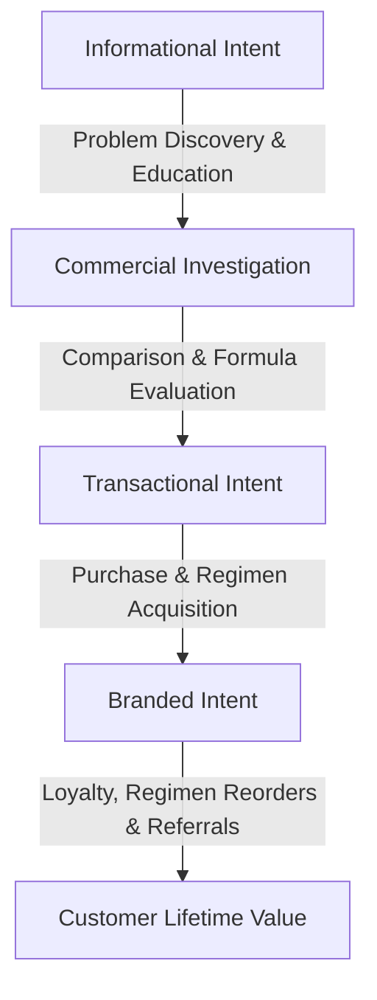

# Keyword Strategy & Page Mapping: Herbic Cure

**Last Verified:** October 13, 2026  
**Audience:** Technical SEO Specialists, Content Editors, Copywriters, Growth Marketers  
**Purpose:** Comprehensive inventory of target search queries mapped by user search intent to application URLs.

> [!IMPORTANT]
> **Data Authenticity Disclaimer (Rule 3 Compliance):**  
> In strict accordance with our engagement ethics, **no search volume numbers or keyword difficulty metrics have been fabricated or guessed**. Search volumes are marked **"Needs input from owner"** until authenticated data is exported directly from the brand's verified Google Search Console property, Google Keyword Planner, Ahrefs, or SEMrush accounts.

---

## 1. Search Intent Architecture Overview

Search queries in the Indian hair care and Ayurvedic beauty landscape partition into four distinct funnel stages:

---

## 2. Exhaustive Keyword Matrix by Search Intent

### A. Informational Keywords (Top-of-Funnel / Education & Rituals)
*Goal: Capture high-intent problem discovery queries, build E-E-A-T topical authority, and introduce classical Ayurvedic methodology before the user is ready to buy.*

| Target Search Query / Phrase | Linguistic Nuance | Primary Search Intent | Target Application URL | Estimated Monthly Search Volume | Content Asset Type |
|---|---|---|---|---|---|
| *what is kshirapak vidhi* | English | Understand traditional milk-decoction oil processing | `/hair-care-tips/science-of-kshirapak-vidhi-hair-fall-control` | Needs input from owner | Blog Post / Deep Guide |
| *kshirapak vidhi benefits for hair* | English | Scientific & Ayurvedic benefits of milk-boiled oil | `/hair-care-tips/science-of-kshirapak-vidhi-hair-fall-control` | Needs input from owner | Blog Post / Deep Guide |
| *baal jhadna kaise roke* | Hinglish | How to prevent acute hair fall naturally | `/hair-care-tips` | Needs input from owner | Pillar Guide / FAQ |
| *baal badhane ka tarika ayurvedic* | Hinglish | Ayurvedic methods to encourage hair resilience | `/hair-care-tips` | Needs input from owner | Pillar Guide |
| *neem wood comb benefits* | English | Discover why wooden combs outperform plastic | `/hair-care-tips/why-switch-to-neem-wood-combs` | Needs input from owner | Dedicated Editorial Article |
| *neem kanghi ke fayde* | Hinglish | Health & scalp benefits of neem comb | `/hair-care-tips/why-switch-to-neem-wood-combs` | Needs input from owner | Dedicated Editorial Article |
| *bhringraj oil benefits for hair fall* | English | Botanical efficacy of Bhringraj (*Eclipta prostrata*) | `/ingredients` | Needs input from owner | Ingredient Herb Encyclopedia |
| *amla and brahmi for hair roots* | English | Synergistic action of Amalaki and Bacopa | `/ingredients` | Needs input from owner | Ingredient Herb Encyclopedia |
| *monsoon hair fall remedies ayurveda* | English / Seasonal | Managing humidity-induced damp shedding | `/hair-care-tips` | Needs input from owner | Seasonal Guide |
| *winter dry scalp champi oil* | English / Seasonal | Treating winter Vata dryness & flaky scalp | `/hair-care-tips` | Needs input from owner | Seasonal Guide |
| *how to apply ayurvedic hair oil* | English | Step-by-step Shiroabhyanga massage instructions | `/how-to-use` | Needs input from owner | Usage & Ritual Guide |
| *can we use 2 in 1 shampoo daily* | English | Frequency of washing and conditioning | `/products/herbic-cure-shampoo-with-conditioner-q1` | Needs input from owner | Product FAQ Section |

---

### B. Commercial Investigation Keywords (Middle-of-Funnel / Consideration & Comparisons)
*Goal: Intercept consumers actively evaluating alternatives to commercial chemical serums or competitor Ayurvedic brands.*

| Target Search Query / Phrase | Linguistic Nuance | Primary Search Intent | Target Application URL | Estimated Monthly Search Volume | Content Asset Type |
|---|---|---|---|---|---|
| *best ayurvedic hair oil for hair fall control in india* | English | Researching top-rated authentic Ayurvedic oils | `/collections/hair-oils` | Needs input from owner | Collection Page / Buyer Guide |
| *kshirapak vidhi hair oil vs normal hair oil* | English | Comparing milk-processed oils vs mineral base oils | `/hair-care-tips/science-of-kshirapak-vidhi-hair-fall-control` | Needs input from owner | Comparison Table & Infographic |
| *21 herbs hair oil review* | English | Evaluating performance and real customer feedback | `/reviews` | Needs input from owner | Verified Customer Reviews Hub |
| *pure neem wood comb vs plastic comb* | English | Evaluating static charge & mechanical breakage | `/products/herbic-cure-natural-neem-wood-comb` | Needs input from owner | Product Detail Page (PDP) |
| *mineral oil free hair oil india* | English | Searching for paraffin-free natural oils | `/collections/hair-oils` | Needs input from owner | Collection Intro & Filter |
| *ayurvedic hair care kit for women* | English | Bundled routine for comprehensive scalp treatment | `/collections/combos` | Needs input from owner | Combo Collection Page |
| *hair fall control oil and shampoo combo* | English | Harmonized duo for cleansing and oiling | `/products/herbic-cure-21-herbs-hair-oil-shampoo-with-conditioner` | Needs input from owner | Combo PDP |

---

### C. Transactional Keywords (Bottom-of-Funnel / High Purchase Intent)
*Goal: Drive immediate conversion for users ready to purchase specific SKUs with pricing, payment, or bundle intent.*

| Target Search Query / Phrase | Linguistic Nuance | Primary Search Intent | Target Application URL | Estimated Monthly Search Volume | Content Asset Type |
|---|---|---|---|---|---|
| *buy 21 herbs fusion hair oil online* | English | Direct purchase of flagship hair oil | `/products/herbic-cure-21-herbs-fusion-hair-oil-q1` | Needs input from owner | Core Product Page |
| *herbic cure 21 herbs hair oil price* | English | Price check and discount verification | `/products/herbic-cure-21-herbs-fusion-hair-oil-q1` | Needs input from owner | Core Product Page |
| *21 herbs hair oil pack of 2 discount* | English | Purchasing 60-day twin value pack | `/products/herbic-cure-21-herbs-fusion-hair-oil-q2` | Needs input from owner | Twin Pack Product Page |
| *21 herbs hair oil pack of 3 family pack* | English | Purchasing 90-day trio value pack | `/products/herbic-cure-21-herbs-fusion-hair-oil-q3` | Needs input from owner | Trio Pack Product Page |
| *buy handcrafted neem wood comb online* | English | Direct accessory purchase | `/products/herbic-cure-natural-neem-wood-comb` | Needs input from owner | Accessory PDP |
| *herbic cure shampoo with conditioner buy* | English | Purchasing 2-in-1 cleanser | `/products/herbic-cure-shampoo-with-conditioner-q1` | Needs input from owner | Cleanser PDP |
| *complete hair therapy kit order online* | English | Purchasing complete 3-piece ritual bundle | `/products/herbic-cure-complete-hair-therapy-kit` | Needs input from owner | Complete Kit PDP |
| *ayurvedic hair oil cash on delivery* | English / Commercial | Placing COD orders across India | `/collections/hair-oils` | Needs input from owner | Collection Page / Trust Badge |

---

### D. Branded Keywords (Brand Navigation & Reputation)
*Goal: Dominate brand SERPs, protect trademark equity, and channel repeat buyers directly to canonical landing pages.*

| Target Search Query / Phrase | Linguistic Nuance | Primary Search Intent | Target Application URL | Estimated Monthly Search Volume | Content Asset Type |
|---|---|---|---|---|---|
| *herbic cure* | Branded English | Primary brand homepage lookup | `/` | Needs input from owner | Homepage |
| *herbic cure hair oil* | Branded English | Direct hero product destination | `/products/herbic-cure-21-herbs-fusion-hair-oil-q1` | Needs input from owner | Product Page |
| *herbic cure official website* | Branded English | Verifying official D2C storefront | `/` | Needs input from owner | Homepage |
| *herbic cure customer reviews* | Branded English | Reputation and legitimacy verification | `/reviews` | Needs input from owner | Customer Reviews Hub |
| *herbic cure results before and after* | Branded English | Visual transformation validation | `/results` | Needs input from owner | Transformations Hub |
| *herbic cure ingredients list* | Branded English | Scrutinizing botanical formulations | `/ingredients` | Needs input from owner | Botanical Herb Directory |
| *herbic cure contact number hyderabad* | Branded English | Reaching WhatsApp support / order tracking | `/contact` | Needs input from owner | Contact & Support Hub |
| *herbic cure track order* | Branded English | Post-purchase shipment tracking | `/track-order` | Needs input from owner | Tracking Utility Page |

---

## 3. On-Page Keyword Deployment & Canonical Architecture

To prevent keyword cannibalization between the single bottle (Q1) and bundle packs (Q2, Q3):
1. **Primary Head Term Allocation:** The root commercial term *"21 Herbs Fusion Hair Oil"* belongs to the flagship product page.
2. **Bundle Query Differentiation:** Multi-packs target intent modifiers explicitly:
   * Q2: *“Pack of 2”*, *“Twin Pack”*, *“60-Day Therapy”*, *“Value Duo”*.
   * Q3: *“Pack of 3”*, *“Family Pack”*, *“90-Day Regimen”*, *“Mega Savings”*.
3. **No Over-Optimization:** Keyword density will remain natural (1.0%–1.8%), prioritizing structured semantic headings (`<h1>`, `<h2>`, `<h3>`), descriptive image alt attributes, and JSON-LD entity properties.
`;

const destPath = path.resolve('d:/Codes/Projects/herbicCure-main/docs/KEYWORDS.md');
fs.writeFileSync(destPath, content, 'utf8');
console.log('Saved docs/KEYWORDS.md successfully to', destPath);
