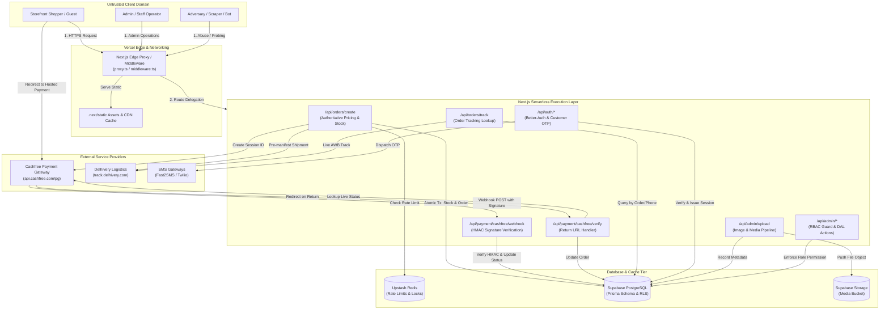

# THREAT MODEL: HERBIC CURE E-COMMERCE PLATFORM

**Application:** Herbic Cure (Ayurvedic E-Commerce Platform & Admin CMS)  
**Target Architecture:** Next.js 16 (App Router), TypeScript, Prisma ORM, Supabase PostgreSQL & Storage, Upstash Redis, Cashfree PG, Delhivery Logistics  
**Security Standard:** OWASP Top 10:2025, OWASP ASVS 5.0 (Target Level 2), STRIDE Methodology  
**Status:** Phase 0 Baseline Assessment  

---

## 1. Asset Inventory

| Asset Category | Specific Data Elements | Sensitivity | Storage Location | Impact of Compromise |
|---|---|---|---|---|
| **Customer PII** | Full name, phone number, personal delivery address, city, state, postal PIN code, email address | **HIGH** (DPDP Act 2023 protected) | Supabase PostgreSQL (`Order`, `Customer`, `Address`, `User`) | Legal non-compliance, regulatory penalties under DPDP Act 2023, customer impersonation, harassment. |
| **Financial & Payment State** | Payment status, gateway transaction IDs (`cf_payment_id`), order total, currency, refund records | **CRITICAL** | Supabase PostgreSQL (`Order`, `RefundRequest`), Cashfree PG | Revenue loss, free merchandise shipment, fraudulent refunds, payment state desynchronization. |
| **Admin & Staff Identities** | Staff emails, Argon2 password hashes, TOTP 2FA secret keys, backup recovery codes, staff invite tokens | **CRITICAL** | Supabase PostgreSQL (`User`, `Account`, `TwoFactor`, `StaffInvite`, `Session`) | Complete administrative takeover, full catalog manipulation, PII exfiltration, malicious order cancellations. |
| **Secrets & API Credentials** | `CASHFREE_APP_ID`, `CASHFREE_SECRET_KEY`, `DELHIVERY_API_KEY`, `UPSTASH_REDIS_REST_TOKEN`, `SUPABASE_SERVICE_ROLE_KEY`, `BETTER_AUTH_SECRET`, `SESSION_SECRET` | **CRITICAL** | Server Environment Variables (`.env`), Vercel Project Secrets | Total platform compromise, fraudulent API transactions, database wiping, third-party bill bombing. |
| **Business Logic & Catalog** | Product regular prices, sale prices, cost prices, physical inventory stock quantities, promotional coupons, discount caps | **HIGH** | Supabase PostgreSQL (`Product`, `Coupon`, `SiteSetting`, `InventoryLog`) | Commercial loss, coupon stacking abuse, zero-rupee checkout, inventory exhaustion, stock overselling. |
| **Brand Content & Media** | Product photography, customer transformation before/after images, video reels, blog posts, reviews | **MEDIUM** | Supabase Storage, Cloudinary, Database Media Table | Brand defacement, stored XSS injection via SVGs or unescaped HTML, unauthorized content deletion. |

---

## 2. Trust Boundaries

```
[ UNTRUSTED ZONE: PUBLIC INTERNET ]
  │ Storefront Shopper / Mobile App / Guest / Malicious Actor
  ▼
═════════════════════════════════════════════════════════════════════ [ TRUST BOUNDARY 1: Edge Ingress ]
  ▼
[ EDGE PROXY & REVERSE PROXY ]
  │ Vercel Edge Network / Next.js Routing
  ▼
═════════════════════════════════════════════════════════════════════ [ TRUST BOUNDARY 2: App Server Runtime ]
  ▼
[ NEXT.JS APP ROUTER CORE RUNTIME ]
  │ API Route Handlers / Server Actions / Middleware / Auth Engines
  ├── Auth Verification (Better-Auth + Custom Session HMAC)
  ├── Input Parsing & Sanitization
  └── Business Logic & Pricing Engine
  │
  ├──► [ UPSTASH REDIS ] (Rate Limiting, Cache Invalidation, Distributed Locks)
  │    ══════════════════════════════════════════════════════════════ [ TRUST BOUNDARY 3: Data Tier ]
  │
  ├──► [ SUPABASE POSTGRESQL & STORAGE ] (Database, RLS, Media Bucket)
  │    ══════════════════════════════════════════════════════════════ [ TRUST BOUNDARY 4: Gateway APIs ]
  │
  ├──► [ CASHFREE PAYMENT GATEWAY ] (Hosted Checkout, Order Status API, Webhooks)
  │    ══════════════════════════════════════════════════════════════ [ TRUST BOUNDARY 5: Logistics API ]
  │
  └──► [ DELHIVERY LOGISTICS ] (Serviceability, Waybill Manifest, Tracking Webhooks)
```

---

## 3. Mermaid Data-Flow Diagram (DFD)



---

## 4. STRIDE Threat Analysis by Component

### A. Client Ingress & Storefront Edge (Browser -> Next.js)
* **Spoofing:** An attacker modifies HTTP headers (`X-Forwarded-For: 1.1.1.1`) to bypass in-memory IP rate limiting. Attacker presents forged session tokens or altered `admin_session` cookies.
* **Tampering:** An adversary alters items, prices, discounts, or delivery fees in the checkout request payload (`/api/orders/create`).
* **Repudiation:** Customers repudiate placed COD orders or claimed unreceived shipments due to missing SMS/WhatsApp verification and delivery OTP confirmation.
* **Information Disclosure:** Unauthenticated consumers enumerate order numbers (`HC-XXXXXX`) or phone numbers via `/api/orders/track` or `/api/orders/user` to extract names, addresses, and purchase history.
* **Denial of Service:** Distributed bots flood `/api/auth/customer/send-otp` or `/api/orders/create` with bogus requests, exhausting SMS gateway credits and overloading serverless lambda execution limits.
* **Elevation of Privilege:** Attackers pass raw JSON session cookies or supply the default `SESSION_SECRET` recovery key to elevate permissions from customer to `OWNER`.

### B. Payment Gateway Pipeline (App Router <-> Cashfree)
* **Spoofing:** Fake webhook POST requests crafted by attackers imitating Cashfree servers to mark unpaid orders as `PAID`.
* **Tampering:** Order return URL parameters (`/api/payment/cashfree/verify?order_id=...`) tampered with to trigger client-side payment success without backend verification.
* **Repudiation:** A customer disputes a completed payment; missing authoritative audit logs linking Cashfree reference numbers (`cf_payment_id`) prevent chargeback defense.
* **Information Disclosure:** Sensitive payment payloads, credit card numbers, or authorization tokens leaked into server logs or error responses.
* **Denial of Service:** Flood of forged webhook events causing expensive cryptographic computations or database lock contention.
* **Elevation of Privilege:** Payment state machine bypass where an order transitioned from `CANCELLED` back to `PAID` via delayed or replayed webhooks.

### C. Shipping & Fulfillment Logistics (App Router <-> Delhivery)
* **Spoofing:** Unauthorized actors triggering shipment cancellation or dispatch without verifying order ownership.
* **Tampering:** Premature manifestation creates active waybills for unpaid orders, resulting in accidental courier dispatch of free merchandise.
* **Repudiation:** Courier status divergence (delivered vs lost) where order status cannot be reconciled due to lack of a tracking webhook handler.
* **Information Disclosure:** Delhivery API tokens or customer addresses intercepted in unencrypted logs or third-party tracking links.
* **Denial of Service:** Generating thousands of fake Delhivery waybills on checkout creation, exceeding logistics quota and incurring carrier fees.
* **Elevation of Privilege:** Forged courier delivery updates flipping payment status from `PENDING` to `PAID`.

### D. Data & Storage Tier (Prisma <-> Supabase PostgreSQL & Storage)
* **Spoofing:** Anonymous access to public PostgreSQL tables via PostgREST endpoint using the public Supabase `anon` key because Row Level Security (RLS) is disabled.
* **Tampering:** Unrestricted file uploads allowing malicious SVG files containing embedded `<script>` tags, causing stored XSS when viewed by admin or visitors.
* **Repudiation:** Missing immutable audit trails for administrative role changes, setting modifications, or refunds.
* **Information Disclosure:** Password hashes, customer PII, and staff invite tokens exposed to unauthorized roles or via SQL/ORM leaks.
* **Denial of Service:** Massive image uploads (up to 60MB) exhausting storage space and server memory during Sharp image transformations.
* **Elevation of Privilege:** Modifying the `role` field on a `User` record via mass-assignment or direct API execution.

---

## 5. Ranked List of Abuse Cases

| Rank | Abuse Scenario | Likelihood | Impact | Severity | Primary Defense Mechanism |
|---|---|---|---|---|---|
| **1** | **Admin Authentication Bypass via Unsigned Raw JSON Session Cookie** | **Confirmed** | **Critical** | **CRITICAL** | Remove raw JSON fallback in `session.ts`; enforce strict HMAC-SHA256 signature verification with timing-safe comparison. |
| **2** | **Master Recovery Key Backdoor Admin Account Takeover** | **Confirmed** | **Critical** | **CRITICAL** | Eliminate the hardcoded `SESSION_SECRET` fallback in `env.ts`; remove `recoveryKey` bypass in `change-password/route.ts`. |
| **3** | **Client-Side OTP Secret Exposure (Complete 2FA / Phone Auth Bypass)** | **Confirmed** | **Critical** | **CRITICAL** | Never send TOTP secret or `sessionSecret` to client; store OTP hashes in DB/Redis with 5-minute TTL; strip `devOtp` from production responses. |
| **4** | **Cashfree Return URL Fallback Payment Bypass (Free Orders)** | **Confirmed** | **Critical** | **CRITICAL** | Fail closed on gateway errors; never default to `PAID`; require verified webhook or authenticated server-to-server API confirmation. |
| **5** | **Cashfree Webhook Signature Bypass & Replay Attacks** | **Likely** | **Critical** | **CRITICAL** | Verify HMAC-SHA256 using raw request body; enforce 5-minute timestamp validity; ensure idempotent processing using `cf_payment_id`. |
| **6** | **Premature Manifestation of Unpaid Orders in Delhivery** | **Confirmed** | **High** | **HIGH** | Defer Delhivery shipment creation until COD is verified or online payment is confirmed `PAID`. |
| **7** | **PostgREST Direct Data Access via Missing Supabase RLS** | **Likely** | **Critical** | **HIGH** | Enable RLS on all public tables; revoke `anon` and `authenticated` role access to sensitive tables. |
| **8** | **In-Memory Rate Limiting Failure & IP Header Spoofing on Serverless** | **Confirmed** | **High** | **HIGH** | Replace in-memory `Map` with `@upstash/ratelimit` over Upstash Redis; validate IP headers using trusted edge proxy properties. |
| **9** | **Stored XSS via Malicious SVG Upload and Hand-Rolled Regex Sanitizer** | **Confirmed** | **High** | **HIGH** | Replace regex sanitizer with `isomorphic-dompurify`; serve uploaded SVGs with `Content-Disposition: attachment` or block SVG uploads. |
| **10** | **Next.js Image Optimization SSRF via Unrestricted `remotePatterns`** | **Confirmed** | **Medium** | **MEDIUM** | Remove wildcards (`**`) and `http:` protocol from `next.config.ts`; restrict to specific allowed image CDNs. |
| **11** | **Order & Tracking Number Enumeration (Sequential `HC-XXXXXX`)** | **Confirmed** | **Medium** | **MEDIUM** | Require both order number AND matching customer phone/email (or signed token) before returning tracking data. |
| **12** | **Coupon Concurrency Race Condition & Infinite Over-Redemption** | **Likely** | **Medium** | **MEDIUM** | Use Prisma interactive transactions with atomic conditional updates (`usedCount < usageLimit`). |
| **13** | **Inventory Stock Overselling Race Condition** | **Likely** | **Medium** | **MEDIUM** | Verify stock and decrement conditionally within an atomic database transaction. |
| **14** | **CSV / Formula Injection in Admin Analytics Export** | **Confirmed** | **Medium** | **MEDIUM** | Sanitize all spreadsheet export fields by prepending a single quote (`'`) to cells starting with `=`, `+`, `-`, or `@`. |
| **15** | **Customer Login Open Redirect via Unsanitized `callbackUrl`** | **Confirmed** | **Medium** | **MEDIUM** | Enforce internal path validation on `callbackUrl` before redirecting. |
| **16** | **Inactive Next.js Edge Proxy (`proxy.ts` not executed by Next.js)** | **Confirmed** | **Medium** | **MEDIUM** | Rename or wrap `src/proxy.ts` into Next.js standard `src/middleware.ts` so edge security and headers actually execute. |
| **17** | **Committed Upstash Redis Token in `.env.example`** | **Confirmed** | **High** | **HIGH** | Rotate Upstash credentials immediately in dashboard; replace with placeholder in repository. |
