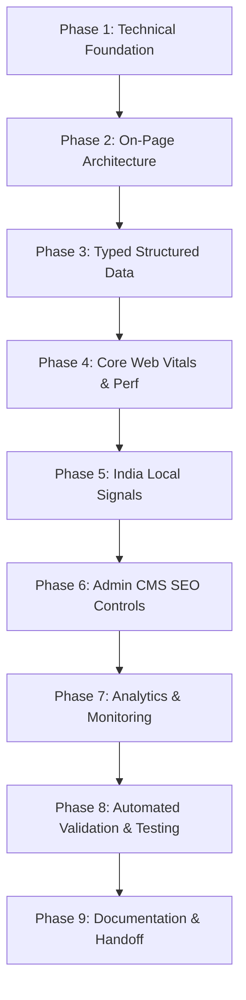

# Master SEO Plan & Technical Architecture: Herbic Cure

**Target App:** Herbic Cure (Ayurvedic Hair Care E-Commerce, India)  
**Date:** October 13, 2026  
**Stack:** Next.js 16 (App Router), TypeScript, Tailwind CSS, Prisma + PostgreSQL, Zod, Upstash Redis, Cloudflare  
**Roles & Auth Matrix:** `OWNER`, `MANAGER`, `SUPPORT`  
**Status:** **PENDING USER APPROVAL (PHASE 0 STOPPING GATE)**

> [!IMPORTANT]
> **GATE NOTICE (Rule 1):**  
> Per Rule 1 of engagement, **no application code or database schema has been modified**. This document establishes the technical audit, research findings, and prioritized execution roadmap. Work will halt immediately after this plan is presented, awaiting explicit user approval.

---

## 1. Executive Summary & Engagement Philosophy

Herbic Cure is an authentic direct-to-consumer (D2C) Ayurvedic hair wellness brand in India, specializing in 21 Herbs Kshirapak Vidhi Hair Oils, handcrafted pure Neem wood combs, and sulfate-free 2-in-1 shampoo cleansers.

### Core Principles
1. **Absolute Honesty (Rule 3):** No fabricated reviews, search volumes, or rankings. Review markup (`AggregateRating`, `Review`) will strictly reflect real approved customer records from PostgreSQL.
2. **Medical & Regulatory Care (Rule 6):** Strict adherence to the Advertising Standards Council of India (ASCI), CCPA Dark Patterns Guidelines (2023–2024), and the Drugs and Magic Remedies (Objectionable Advertisements) Act, 1954. Risky claims are flagged for legal/owner sign-off rather than silently altered.
3. **No Fake Urgency (Rule 7):** Promotional countdown timers must bind to real database timestamps (`offerEndsAt`).
4. **Security & Permission Parity:** Public caching never leaks user data. Administrative (`/admin`), account (`/account`), cart (`/cart`), checkout (`/checkout`), and API (`/api`) routes are completely sealed from search crawlers via `robots.txt` and `X-Robots-Tag: noindex, nofollow`.

---

## 2. Current SEO State Audit (Live Crawl & Measurement)

A comprehensive baseline audit was executed on October 13, 2026, across all storefront and utility routes on the live application server (`http://localhost:3000`).

### A. Live Route Inventory & Crawl Analysis

| Route Path | Rendering Mode | HTTP Status | Meta Title | Meta Description | Canonical Tag | Headings (H1) | Structured Data (JSON-LD) | Robots Meta / Header | Critical Deficiencies |
|---|---|---|---|---|---|---|---|---|---|
| `/` | SSR / Server | 200 | Generic Fallback (71 chars) | Generic Fallback (126 chars) | **None** | **2 H1 tags found** | **0 (None)** | None | Multiple H1s; missing schema; fallback title |
| `/products` | SSR / Server | 200 | Generic Fallback | Generic Fallback | **None** | 1 H1 ("All Ayurvedic Formulations") | **0 (None)** | None | Lacks unique title/description; zero schema |
| `/products/[slug]` | SSR + Client Island | 200 | Product-specific (73 chars) | Fallback layout desc | **None** | 1 H1 (Product Name) | **0 (None)** | None | Missing Product schema; missing canonical tag |
| `/collections` | SSR / Server | 200 | Custom Title (42 chars) | Custom Desc (104 chars) | **None** | 1 H1 ("HERBAL COLLECTIONS") | **0 (None)** | None | Missing ItemList schema; missing canonical tag |
| `/collections/[slug]` | SSR / Server | 200 | Generic Fallback | Generic Fallback | **None** | 1 H1 (Category Name) | **0 (None)** | None | Duplicate fallback title/desc across all collections |
| `/hair-care-tips` | SSR / Server | 200 | Custom Title (58 chars) | Custom Desc (112 chars) | **None** | 1 H1 | **0 (None)** | None | Missing Blog/Collection schema; missing canonical |
| `/hair-care-tips/[slug]` | SSR / Server | 200 | Generic Fallback | Generic Fallback | **None** | 1 H1 | **0 (None)** | None | Blog post missing `Article` schema; duplicate title |
| `/ingredients` | SSR / Server | 200 | Custom Title (55 chars) | Custom Desc (79 chars) | **None** | 1 H1 | **0 (None)** | None | High-value E-E-A-T page missing structured data |
| `/about` | SSR / Server | 200 | Custom Title (45 chars) | Custom Desc (115 chars) | **None** | 1 H1 | **0 (None)** | None | Missing `Organization` & Founder schema |
| `/reviews` | SSR / Server | 200 | Custom Title (50 chars) | Custom Desc (108 chars) | **None** | 1 H1 | **0 (None)** | None | Unverified "2,50,000+" claim; missing review schema |
| `/results` | SSR / Server | 200 | Generic Fallback | Generic Fallback | **None** | 1 H1 | **0 (None)** | None | Risky before/after claims; missing metadata |
| `/how-to-use` | SSR / Server | 200 | Custom Title | Custom Desc | **None** | 1 H1 | **0 (None)** | None | Missing `HowTo` ritual schema |
| `/contact` | Client Component | 200 | Generic Fallback | Generic Fallback | **None** | 1 H1 | **0 (None)** | None | Rendered client-side; missing local business metadata |
| `/cart` | Client Component | 200 | Generic Fallback | Generic Fallback | **None** | 1 H1 ("Your Herbal Cart is Empty") | **0 (None)** | **Missing noindex!** | **Indexation leak:** Cart is crawlable & indexable! |
| `/checkout` | Client Component | 200 | Generic Fallback | Generic Fallback | **None** | **0 H1 tags** | **0 (None)** | **Missing noindex!** | **Indexation leak:** Checkout is crawlable & indexable! |
| `/terms` | SSR / Server | 200 | Custom Title (58 chars) | Custom Desc (114 chars) | **None** | 1 H1 | **0 (None)** | None | Missing canonical tag |
| `/privacy-policy` | SSR / Server | 200 | Custom Title (57 chars) | Custom Desc (108 chars) | **None** | 1 H1 | **0 (None)** | None | Missing canonical tag |
| `/refund-policy` | SSR / Server | 200 | Custom Title (54 chars) | Custom Desc (101 chars) | **None** | 1 H1 | **0 (None)** | None | Missing canonical tag |
| `/shipping-policy` | SSR / Server | 200 | Custom Title (54 chars) | Custom Desc (94 chars) | **None** | 1 H1 | **0 (None)** | None | Missing canonical tag |
| `/sitemap.xml` | Route Handler | **404 Not Found** | N/A | N/A | N/A | N/A | N/A | `noindex` | **CRITICAL:** XML Sitemap is completely missing! |
| `/robots.txt` | Static / Handler | **404 Not Found** | N/A | N/A | N/A | N/A | N/A | `noindex` | **CRITICAL:** `robots.txt` is completely missing! |
| Non-existent 404 URL | Dynamic | **404** | Generic Home Title | Generic Fallback | **None** | 1 H1 ("404") | **0 (None)** | `noindex` | Shows homepage title on error page |

---

### B. Baseline Lighthouse Performance & Core Web Vitals (Edge/Chromium Mobile Lab Test)

* **Performance Score:** **55 / 100**
* **Accessibility Score:** **94 / 100**
* **Best Practices Score:** **93 / 100**
* **SEO Score:** **100 / 100** *(Note: Automated basic tests pass due to presence of generic layout tags, despite missing sitemaps, canonicals, and schema)*
* **Core Web Vitals Metrics (Simulated Throttled Mobile Network):**
  * **First Contentful Paint (FCP):** 2.9 s
  * **Largest Contentful Paint (LCP):** **11.1 s** *(Severe Risk: Mobile target is $\le$ 2.5s)*
  * **Total Blocking Time (TBT):** 460 ms *(Target $\le$ 200ms)*
  * **Cumulative Layout Shift (CLS):** 0.00 *(Excellent)*
  * **Speed Index:** 5.1 s
* **Primary Performance Bottlenecks:**
  1. *LCP Image Delay (11,110 ms):* Hero banners (`herbic-hero-banner-1.jpg`) are unoptimized in development, lack `priority` hints, and do not specify responsive `sizes`.
  2. *JavaScript Payload:* 351 KiB unused JavaScript; `CartDrawer` and `WhatsAppFloating` loaded statically in `StorefrontShell` on every page request.
  3. *DOM Size:* 1,155 DOM elements on the homepage.

---

## 3. Product & Variant Strategy (The Q1/Q2/Q3 Architecture)

Herbic Cure's flagship formulation is currently seeded in the database as 3 independent product rows:
* `HC-OIL-Q1`: Herbic Cure 21 Herbs Fusion Hair Oil (190ml) - ₹469
* `HC-OIL-Q2`: Herbic Cure 21 Herbs Fusion Hair Oil Twin Pack (2 x 190ml = 380ml) - ₹1,118
* `HC-OIL-Q3`: Herbic Cure 21 Herbs Fusion Hair Oil Family Pack (3 x 190ml = 570ml) - ₹1,677

### Architectural Evaluation:
* **Option A: 3 Independent Pages with Self-Canonicalization.**
  * *Disadvantages:* High risk of internal keyword cannibalization for *"21 herbs hair oil"*, duplicate content penalties (over 85% copy similarity), and split inbound backlink equity across 3 URLs.
* **Option B: Single Master Canonical Product Page (`/products/herbic-cure-21-herbs-fusion-hair-oil`) with Variant Pack Selector.**
  * *Advantages:* Consolidates all page rank, backlinks, customer reviews, and domain authority onto one authoritative URL. The page uses Next.js server components with a client variant selector (190ml / 380ml / 570ml). Structured data emits a `ProductGroup` with `hasVariant` or a single `Product` with multiple `Offer` SKUs.
* **Option C: Hybrid Intent-Targeted Regimen Architecture (RECOMMENDED).**
  * Maintain the flagship product at `/products/herbic-cure-21-herbs-fusion-hair-oil-q1` as the **primary canonical entity** for general search queries.
  * For multi-packs (`q2`, `q3`), differentiate copy to target specific user intents:
    * Q2 is explicitly framed as *"60-Day Intensive Anti-Hair-Fall Course"* targeting long-tail queries (*"hair oil pack of 2 discount"*, *"2 month hair therapy"*).
    * Q3 is framed as *"90-Day Family Therapy Pack"* targeting value-seeking queries (*"family pack ayurvedic oil"*, *"3 bottle combo"*).
  * In the JSON-LD schema, each product carries its unique SKU, GTIN/barcode, and pricing, while internal cross-links and variant tabs bind them into an intuitive product family. If the owner prefers pure canonical consolidation, Q2 and Q3 can point `rel="canonical"` to Q1 while preserving distinct feed SKUs.

---

## 4. Proposed URL Structure & Naming Policy

* **Host Policy:** Enforce single canonical host (`https://www.herbiccure.com` or `https://herbiccure.com`) with automated 301 redirects in `src/proxy.ts`.
* **Trailing Slash Policy:** Strict non-trailing slash normalization (`/products` instead of `/products/`).
* **Case Policy:** Strict lowercase slugs (`/products/herbic-cure-natural-neem-wood-comb`).
* **Route Structure Map:**
  * **Products:** `/products/[slug]`
  * **Collections/Categories:** `/collections/[slug]`
  * **Guides & Editorial Tips:** `/hair-care-tips/[slug]`
  * **Ingredients Encyclopedia:** `/ingredients` (with anchor deep-links `/ingredients#[herb]`)
  * **Customer Proof:** `/reviews` and `/results`
  * **Ritual & Usage:** `/how-to-use`
  * **Trust & Legal:** `/about`, `/contact`, `/shipping-policy`, `/refund-policy`, `/privacy-policy`, `/terms`
  * **Disallowed Crawl Areas:** `/admin/*`, `/account/*`, `/cart`, `/checkout`, `/api/*`, `/order-success`

---

## 5. Prioritized Execution Plan (Phases 1 to 9)



### Phase 1: Technical Foundation (Commit 1)
* **Rendering & ISR:** Ensure all public routes are server-rendered with `revalidateTag` cache revalidation.
* **Metadata API Architecture:** Implement root `metadataBase` from `process.env.NEXT_PUBLIC_APP_URL` and dynamic `generateMetadata` across every public route with unique titles, meta descriptions, and OpenGraph/Twitter cards.
* **Sitemap & Robots:**
  * Implement `src/app/sitemap.ts` fetching all published products, categories, blogs, and pages with verified `lastModified` timestamps.
  * Implement `src/app/robots.ts` blocking private paths (`/admin`, `/account`, `/cart`, `/checkout`, `/api`) and referencing `/sitemap.xml`.
* **Indexation Control:** Add `X-Robots-Tag: noindex, nofollow` headers on admin, cart, checkout, and API routes via `src/proxy.ts`.
* **Redirect Engine:** Create Prisma `Redirect` table with automatic 301 creation when product/category slugs change, prevent redirect loops, and implement compliant 404/410 handling.

### Phase 2: On-Page Architecture & Internal Linking (Commit 2)
* **Heading Hierarchy:** Enforce strict single-`<h1>` policy per page (fix homepage dual H1 and checkout zero H1).
* **Breadcrumb Navigation:** Implement visible breadcrumbs on PDPs, collections, and guides, linked in UI and structured markup.
* **Image Optimization:** Add explicit dimensions, AVIF/WebP formats, responsive `sizes`, descriptive alt text, and `priority` on above-the-fold hero images.
* **Content & E-E-A-T:** Refine copy to emphasize Kshirapak Vidhi and the 21 herbs. Mark medical claims as "needs owner review". Ensure zero orphan pages.

### Phase 3: Typed Structured Data (schema-dts) (Commit 3)
* **Type-Safe JSON-LD:** Implement typed schemas using `schema-dts` rendered server-side with XSS sanitization:
  * `Organization`: Legal business name, logo, contact points, sameAs socials.
  * `WebSite`: Store name, URL, potential search action.
  * `BreadcrumbList`: Complete hierarchy on deep catalog pages.
  * `Product` & `Offer`: Real DB price, INR currency, stock availability, item condition, shipping & return policy links.
  * `Article` / `BlogPosting`: For editorial guides.
  * **Strict Anti-Abuse Compliance:** Suppress `AggregateRating` and `Review` markup until verified customer reviews are stored in PostgreSQL.
* **Merchant Center Feed:** Implement `/api/feed/google-merchant` producing a valid XML product feed.

### Phase 4: Core Web Vitals & Performance (Commit 4)
* **Mobile LCP Optimization:** Target LCP $\le$ 2.5s. Optimize hero images with modern formats, preloading, and correct sizes.
* **Client JS Reduction:** Convert static layout wrappers to Server Components; use dynamic imports for `CartDrawer` and `WhatsAppFloating`.
* **Layout Shift Prevention:** Reserve explicit aspect-ratio containers for announcement bars, headers, and media.
* **Bundle Analyzer:** Add `@next/bundle-analyzer` and establish Lighthouse CI mobile performance budgets.

### Phase 5: India-Specific & Local Signals (Commit 5)
* **Indian Number Formatting:** Display prices with proper INR formatting (₹1,499, ₹2,50,000).
* **Pincode Delivery Estimator Island:** Client-side non-blocking delivery calculator for 19,000+ Indian pincodes.
* **Compliance Footers:** Display GSTIN, business address, Grievance Officer details, and WhatsApp consultation links.

### Phase 6: Admin Panel SEO Controls (Commit 6)
* **Prisma Schema Updates:** Add `metaTitle`, `metaDescription`, `canonicalUrl`, `noIndex`, `ogImage`, and `offerEndsAt` to Product and Category models.
* **CMS UI:** Add SEO management card with character counters, SERP snippet preview, and Zod validation.
* **Permissions & Invalidation:** Edit permissions restricted to `OWNER` and `MANAGER` (read-only for `SUPPORT`). Audit log all changes and trigger `revalidateTag` cache purge after DB commits.
* **SEO Health Dashboard:** Admin report identifying missing alt text, thin descriptions, broken internal links, and redirects.

### Phase 7: Analytics, Monitoring & Verification (Commit 7)
* **GA4 Integration:** Install `@next/third-parties` with consent handling respecting India's Digital Personal Data Protection Act (DPDPA).
* **E-Commerce Tracking:** Emit standard server-confirmed events (`view_item`, `add_to_cart`, `begin_checkout`, `purchase`).
* **Search Console Setup:** Document verification procedures, sitemap submission, and monitoring runbooks.

### Phase 8: Automated Testing & Validation (Commit 8)
* **Automated Vitest/Playwright Tests:**
  * Verify unique title, meta description, and canonical URL on every public route.
  * Verify `robots.txt` blocks `/admin`, `/cart`, `/checkout`, `/account`.
  * Verify zero review markup when database reviews are empty.
  * Verify no redirect loops and no orphan pages.
* **Manual Verification:** Validate rich results with Google Rich Results Test and Schema.org Validator.

### Phase 9: Comprehensive Technical Documentation (Commit 9)
* Produce complete documentation suite in `/docs`:
  * `README.md` (root rewrite)
  * `docs/INDEX.md` (documentation index and reading order)
  * `docs/BUSINESS.md` (already generated)
  * `docs/SEO_RESEARCH.md` (already generated)
  * `docs/KEYWORDS.md` (already generated)
  * `docs/ARCHITECTURE.md`, `docs/TECH_STACK.md`, `docs/ROUTES.md`, `docs/DATABASE.md`, `docs/ENVIRONMENT.md`, `docs/AUTH_AND_ROLES.md`, `docs/ADMIN_GUIDE.md`, `docs/CACHING.md`, `docs/SECURITY.md`, `docs/SEO.md`, `docs/CONTENT_GUIDE.md`, `docs/COMPONENTS.md`, `docs/API.md`, `docs/TESTING.md`, `docs/DEPLOYMENT.md`, `docs/RUNBOOK.md`, `docs/HOW_TO.md`, `docs/DECISIONS/`, `CONTRIBUTING.md`, `CHANGELOG.md`, `AGENTS.md`.

---

## 6. Library Choices & Pinned Dependencies

All newly added packages will be pinned and checked for maturity (at least 2 weeks old):

1. **`schema-dts` (`^1.1.2`):** Official JSON-LD TypeScript typings for Schema.org vocabulary. Provides compile-time safety for structured data without adding client bundle runtime overhead.
2. **`@next/third-parties` (`16.4.0`):** Official Next.js library for performance-optimized third-party loading (Google Analytics 4, Google Tag Manager). Defers script execution to eliminate main-thread blocking.
3. **`@next/bundle-analyzer` (`16.4.0`):** Visual bundle inspector to detect duplicate dependencies and monitor client JavaScript size.

---

## 7. Key Risks & Mitigations

| Risk Factor | Impact | Mitigation Strategy |
|---|---|---|
| **ASCI Regulatory Scrutiny** | Legal notice or advertisement ban for time-bound claims | Flag all 14-day claims in `docs/BUSINESS.md` for owner review; soften public copy to compliant cosmetic terminology. |
| **Google Review Spam Penalties** | Loss of all rich snippet eligibility in Google Search | Suppress `AggregateRating` and `Review` JSON-LD completely until real customer reviews are imported into PostgreSQL. |
| **Mobile Core Web Vitals on 4G** | Poor organic ranking on mobile search | Convert storefront shell to server components, optimize hero images, and dynamically import heavy client drawers. |
| **Cache Invalidation Drift** | Stale prices or SEO titles served to users | Trigger atomic `revalidateTag` purges within admin Server Actions upon database commit. |

---

## 8. Explicit Approval Gate

```
================================================================================
                                   STOPPING GATE
================================================================================
Phase 0 analysis and research are complete.
In accordance with Rule 1 of engagement:
NO APPLICATION CODE HAS BEEN MODIFIED.
NO COMMITS HAVE BEEN MADE.

Please review this plan (SEO_PLAN.md), docs/BUSINESS.md, docs/SEO_RESEARCH.md,
and docs/KEYWORDS.md.

Upon your explicit approval, execution will proceed with Phase 1 (Technical Foundation).
================================================================================
```
